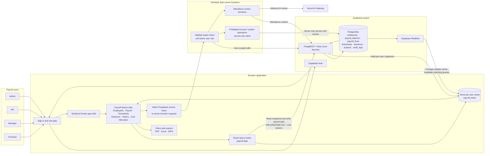
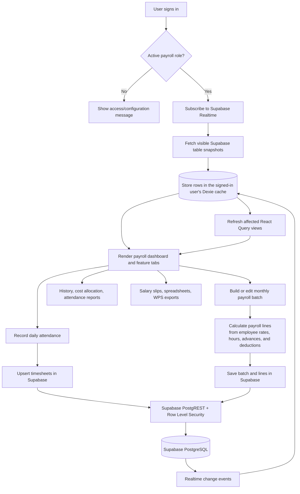

# Application architecture

## Runtime architecture

## Payroll and attendance flow

## Boundaries and source of truth

- The browser uses Supabase Auth and the publishable key. Database access is constrained by
  Supabase Row Level Security; the browser does not receive a service-role key.
- Supabase PostgreSQL is the source of truth. The per-user Dexie database is a local read
  cache, populated from Supabase and kept current through Realtime; it is not a write queue
  or backup.
- Payroll data access and mutations are organized in `src/lib/payroll-data.ts`. Feature
  views are in `src/components/payroll/`.
- TanStack Start server functions receive a bearer token through the function middleware and
  validate it before running. Privileged account and project management uses a server-only
  service-role client. Attendance-review functions call the AI Gateway for advisory results.
- PDF, spreadsheet, and WPS file generation runs in the browser using the existing export
  helpers in `src/lib/`.
